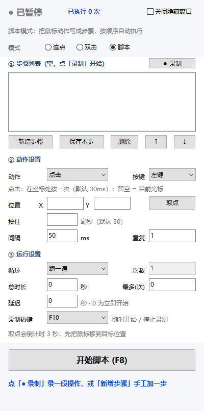
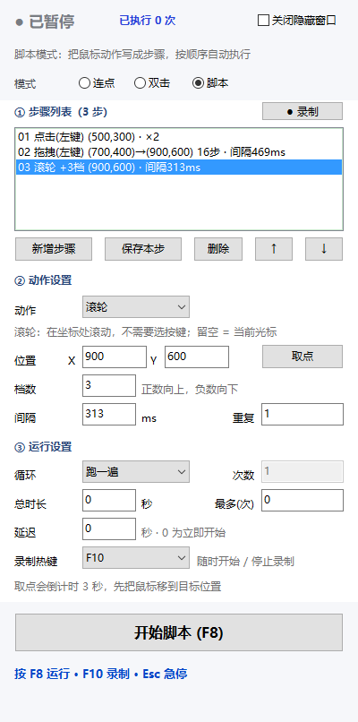

<p align="center">
  <a href="resources/logo/mouseclick-neon.svg">
    
  </a>
</p>

# 鼠标连点器（mouseclick）

一个运行在 Windows 桌面的鼠标连点工具：支持左键 / 中键 / 右键，支持**连点、双击、脚本（动作序列）**三种模式，支持**录制鼠标操作自动生成步骤**、全局热键启停、锁定点击位置和配置记忆。界面由 **ENERGY GUI Designer + LCL** 构建，业务逻辑使用 Go。

> 适合重复点击、批量确认、界面测试等需要固定节奏点击的场景。请只在你有权操作的窗口和程序中使用。

## 界面预览

| 连点模式（默认 20 次/秒） | 双击模式（双击间隔 100 ms / 组间隔 300 ms） |
|:---:|:---:|
|  |  |

脚本模式：一串动作按顺序执行，每步可以是点击、长按、拖拽或滚轮。面板按 ① 步骤列表 → ② 动作设置 → ③ 运行设置 三段展开，先选步骤、再调参数、最后设循环与上限。步骤列表右上角的「● 录制」可以直接录一段鼠标操作，再逐条改成需要的参数。



录制完成后，步骤会自动追加进列表并选中最后一步，② 里的参数可以直接接着改：



截图在暂停状态抓取，使用全新配置、未锁定点击位置；右上角是累计点击次数。开始后会有 0.8 秒预热，状态从「即将开始」变为「运行中」，按钮同时变为「暂停」（脚本模式为「停止脚本」）。

## 功能

- **鼠标按键**：左键、中键、右键三选一。
- **连点模式**：按固定间隔连续点击，速度范围 1–50 次/秒，默认 20 次/秒（间隔 50 ms）。
- **双击模式**：每组连续点击两次后等待，再进入下一组。
  - 双击间隔：两次点击之间，范围 30–300 ms，默认 100 ms。
  - 组间隔：每组两次点击后等待，范围 20–1000 ms，默认 300 ms。
- **模式独立参数**：连点速度与双击间隔 / 组间隔分别保存，切换模式不会覆盖另一组参数。
- **录制鼠标动作**：脚本模式里点「● 录制」，倒计时后自动开始记录点击、拖拽和滚轮，停止后直接变成步骤，可再逐条改参数——先录一段再微调，比手填快得多。录制另有独立热键（默认 `F10`），在任何模式下按一下就开始录、再按一下停止，不用先回到窗口点按钮。
- **全局热键启停**：默认 `F8`，可在下拉框选择 `Ctrl+F8`、`Ctrl+F9`、`Ctrl+F10`、`Alt+F8`、`Alt+F9`、`F8`–`F12`。
- **录制热键**：默认 `F10`，可选同一组按键；在 ③ 运行设置里改。和启停热键重复时会提示并自动顺移，注册失败也会回滚提示。
- **锁定点击位置**：勾选时把当前鼠标位置固定为点击点；运行中光标会被固定在该位置，适合点固定按钮。
- **配置记忆**：按键、模式、速度、双击参数、热键、锁定状态、坐标和「关闭隐藏窗口」状态都会写入本地 JSON，下次启动自动恢复。
- **关闭到托盘**：勾选窗口右上角的「关闭隐藏窗口」后，点击窗口的 × 只隐藏窗口，点击引擎继续运行；未勾选时 × 直接退出。托盘菜单中的「退出程序」不受该复选框影响，始终直接退出。
- **状态反馈**：显示「已暂停 / 即将开始 / 运行中」、累计点击次数和热键注册失败提示。
- **安全退出**：真正退出前先释放鼠标按键，再结束点击循环，避免鼠标键卡住。
- **脚本模式（动作序列）**：选「脚本」进入序列编辑，把「连点」升级成简易流程自动化。
  - 步骤列表：每行一个动作，可添加、删改、上下移动，支持最多 300 步。
  - 动作类型：点击（可设按下时长）、长按（保持 N 毫秒）、拖拽（起点到终点、分 N 步）、滚轮（正数向上、负数向下）。
  - 每步参数：屏幕坐标（留空表示沿用当前光标位置）、按键、间隔、重复次数。
  - 坐标取点：点「取起点 / 取终点」后有 3 秒倒计时，把鼠标移到目标位置即自动填入，不用手抄坐标。
  - 循环方式：跑一遍、循环 N 次、一直循环。
  - 运行控制：限总时长、限点击数、延迟启动；运行中按 `Esc` 立即急停。
  - 进度显示：底部实时显示第几步、第几轮、已执行多少次，以及停止原因（到时 / 到量 / 跑完 / Esc）。
  - 录制起稿：点「● 录制」或直接按录制热键（默认 `F10`），3 秒倒计时后窗口自动最小化，正常操作目标程序即可；再按一次 `F10`（或 `F8`）停止，把录到的点击 / 拖拽 / 滚轮追加进步骤表，再改坐标、间隔、重复次数。

## 快速开始（通过 ENERGY GUI Designer 运行）

> 程序依赖 ENERGY GUI Designer 维护的 LCL / energy 运行时，请按下面的方式从 Designer 启动。

一、获取 [ENERGY GUI Designer](https://github.com/energye/designer)

1. 启动 **ENERGY GUI Designer**。
2. 打开项目文件 `mouseclick.egp`。
3. 点击工具栏上绿色三角形的 **「运行预览(F9)」**。
4. Designer 会加载 `github.com/energye/lcl`、`github.com/energye/energy/v3` 等依赖，并启动「鼠标连点器」窗口。
5. 把鼠标移到要点击的位置；在「模式」里选「连点」或「双击」，选择鼠标按键，按需要调整速度或双击参数。
6. 按 `F8`（或下拉框中选择的其它热键）开始；再按一次暂停。

二、使用预构建的安装程序

说明：

- `F9` 是 Designer 的「运行预览」快捷键；本工具自己的启停热键默认是 `F8`，两者不冲突。
- Designer 运行预览时会自动编译并直接启动窗口，不需要额外执行构建命令，也不要把 `build/` 下的产物当作独立运行程序。
- 安装包和发布流程由你自己的 Designer 发布方式处理，本文不涉及打包步骤。

### 使用「锁定点击位置」

1. 先把鼠标移到目标位置。
2. 勾选「锁定点击位置」，程序会记录当前坐标。
3. 按热键开始后，光标会被固定在目标点。
4. 此时「开始 / 暂停」按钮可能被连点光标抢占，建议始终用全局热键暂停。

### 使用「脚本模式」

1. 在「模式」里选「脚本」，窗口纵向展开为序列编辑面板；顶部单选仍可见，随时能切回「连点 / 双击」。
2. ① 步骤列表中每行一个动作，点「新增步骤」建空白步，填好后点「保存本步」写回当前行；「删除 / ↑ / ↓」调整列表。
3. ② 动作设置里选动作类型与按键：拖拽时坐标行是「起点 / 终点」，其它动作是「位置」；坐标留空表示执行时用当前光标位置，也可以点「取点 / 取起点 / 取终点」抓取——3 秒倒计时后自动填入。
4. 动作不同，参数行会跟着变：点击显示「按住」、长按显示「长按」、拖拽多出终点行与「步数」、滚轮只有「档数」且隐藏按键。
5. ③ 运行设置里选循环方式（跑一遍 / 循环 N 次 / 一直循环）、总时长、最多点击、延迟启动；只有「循环 N 次」时「次数」才可填，其它方式下置灰。按 `F8` 或「开始脚本」运行。
6. 运行中底部会显示第几步 / 第几轮 / 已执行次数，按钮变为「停止脚本」；按 `Esc` 立即停止，不必去抢窗口按钮。
7. 拖拽步骤必须同时有起点和终点，缺一个时不会保存，② 下方的提示会变红说明原因；点「保存本步」前也要先在列表里选中一行。

### 用「录制」快速起稿（录制 + 自定义）

不想一条条手填时，先录一段再改：

1. 按录制热键（默认 `F10`）——在任何模式下都行，窗口会自动切到「脚本」并开始 3 秒倒计时；也可以切到「脚本」后点 ① 步骤列表右上角的「● 录制」。
2. 倒计时结束窗口自动最小化，开始记录鼠标动作；想临时反悔（还在倒计时中），再按一次录制热键即可取消。
3. 到目标程序里正常操作：单击、按住拖拽、滚轮都可以。同一位置的连续点击会合并成「重复次数」，同方向连续滚轮会合并成「档数」，拖拽按实际按住时长换算成「步数」。
4. 再按一次录制热键（默认 `F10`）停止；启停热键（默认 `F8`）也能停。两个键都没反应时，可以点任务栏把窗口还原，再点「■ 停止」——点「停止」这一下不会被记进步骤。
5. 停止后窗口还原，步骤自动追加到 ① 列表，底部提示「已录制 N 步」。选中某一行，用 ② 里的坐标 / 间隔 / 重复次数逐条微调，最后在 ③ 里设循环与上限。
6. 录制热键和启停热键一样在 ③ 运行设置里改（「录制热键」下拉框），两键不能相同；换成已被其他程序占用的键时，底部红字提示并保留原来的键。

说明：录制只跟鼠标（点击、拖拽、滚轮），不记录键盘输入；录制期间不要再用这个鼠标做无关操作，否则也会被记下来。

### 热键被占用

全局热键是系统独占的。若 `F8`（启停）或 `F10`（录制）已被其他程序占用，窗口底部会显示红色提示，原来的键仍保持有效；在 ③ 里换一个即可。同时启动多个实例时，后启动的实例也会出现这个提示，这是正常现象。
少数程序会装低级键盘钩子把某些键吞掉（例如本机实测 `F9` 能注册成功但按下去没反应），遇到录制热键「按了没动静」时，直接换个键试（`F8`、`F10`、`F11` 一般可用）。

## 依赖关系

程序入口和运行链路如下：

```text
main.go
  └─ lcl.Init() / lcl.Run(app.Forms...)
       └─ app.Form1（LCL 窗口和控件）
            ├─ app/form1.go       业务逻辑、事件、样式
            ├─ app/engine.go      连点引擎和状态机
            ├─ app/runner.go      脚本（序列）执行器、运行控制与 Esc 急停
            ├─ app/sequence.go    步骤与序列配置模型
            ├─ app/sequi.go       脚本模式界面（运行时创建，不改 Designer 布局）
            ├─ app/record.go      录制状态机（点击合并、滚轮合并、拖拽换算）
            ├─ app/record_windows.go 低级鼠标钩子（录制真实鼠标输入）
            ├─ app/config.go      本地 JSON 配置
            └─ app/input_windows.go / hotkey_windows.go
                 └─ SendInput / RegisterHotKey（Windows 原生 API）
```

主要依赖：

| 依赖 | 版本 | 作用 |
|---|---|---|
| Go | 1.20+ | 编译和运行 |
| `github.com/energye/lcl` | `v1.0.10` | LCL 界面框架、窗口和原生控件 |
| `github.com/energye/energy/v3` | `v3.0.17` | `application/pack` 应用元信息、运行时集成 |
| `github.com/ebitengine/purego` | `v0.10.0`（间接） | LCL 依赖的动态库调用 |
| `libenergy-amd64.dll` | 由 ENERGY Designer 维护 | LCL 的 Windows 原生运行时 |

说明：

- 本机开发和运行由 ENERGY GUI Designer 维护 `%USERPROFILE%\.energy\runtime` 下的 `libenergy-amd64.dll`；本地 `build` 目录不需要手动复制 DLL。
- 如果要把程序分发到其他机器，请按你自己的 Designer 发布流程处理，确保运行时库与程序一起分发，不要只拷贝单个文件。
- macOS / Linux 目前只保留界面和配置逻辑的编译入口；鼠标注入和全局热键只在 Windows 下实现，不能实际点击。

## 在 Designer 中修改与运行

1. 用 ENERGY GUI Designer 打开 `mouseclick.egp`。
2. 界面布局在 `layouts/form1.ui` 中维护；打开 Designer 后可直接在画布上调整控件。
3. 修改后先保存，再点击 **「运行预览(F9)」** 编译并启动，验证界面和交互。
4. 业务逻辑在 `app/form1.go`，Designer 不会覆盖这部分；`app/form1.ui.go` 是生成代码，不要手改。
5. Designer 的运行输出目录是 `build/`，本仓库不提交这些构建产物。

如果只想做静态检查，可在项目根目录执行：

```bat
go vet ./...
```

## 配置记忆

配置文件路径：

```text
%LOCALAPPDATA%\mouseclick\config.json
```

目录名优先取 `app.Info.Name`；若 `Info.Name` 为空，回退为可执行文件名。macOS / Linux 使用 `os.UserConfigDir()` 的系统配置目录。

默认配置：

```json
{
  "rate": 20,
  "button": "left",
  "hotkey": "F8",
  "recordHotkey": "F10",
  "mode": "single",
  "doubleGap": 100,
  "doubleInterval": 300,
  "lock": false,
  "lockX": 0,
  "lockY": 0,
  "closeToTray": false,
  "sequence": {
    "steps": [],
    "loopMode": "once",
    "loopCount": 1,
    "maxDurationSec": 0,
    "maxClicks": 0,
    "startDelayMs": 0
  }
}
```

| 字段 | 说明 |
|---|---|
| `rate` | 单击模式速度，1–50 次/秒 |
| `button` | `left` / `middle` / `right` |
| `hotkey` | 启停热键名称，如 `F8`、`Ctrl+F8` |
| `recordHotkey` | 录制热键名称，默认 `F10`；与 `hotkey` 重复时自动改用下一个可用项 |
| `mode` | `single`（单击）/ `double`（双击）/ `script`（脚本） |
| `doubleGap` | 双击两次点击之间的间隔，30–300 ms |
| `doubleInterval` | 双击每组结束后的组间隔，20–1000 ms |
| `lock` / `lockX` / `lockY` | 是否锁定点击位置及锁定的屏幕坐标 |
| `closeToTray` | 点击窗口 × 时是否只隐藏到托盘；`false` 为直接退出 |
| `sequence` | 脚本模式的步骤表与运行控制，见下 |

`sequence.steps` 的每一项：

| 字段 | 说明 |
|---|---|
| `action` | `click` / `hold` / `drag` / `wheel` |
| `button` | `left` / `middle` / `right` |
| `x` / `y` | 屏幕坐标，`-1` 表示沿用当前光标位置 |
| `x2` / `y2` | 拖拽终点，`-1` 表示未设置 |
| `param` | 长按毫秒数、拖拽步数、滚轮档数（正数向上、负数向下） |
| `delayMs` | 本步执行完后的等待 |
| `repeat` | 本步重复次数 |

`sequence` 的运行控制：`loopMode` 为 `once` / `count` / `forever`，`loopCount` 为循环次数，`maxDurationSec` 为总时长上限（0 不限），`maxClicks` 为最多执行次数（0 不限），`startDelayMs` 为按下热键后的延迟（毫秒）。

速度滑块使用 300 ms 防抖写盘；按键、模式、热键、锁定项即时排队写入；关闭窗口时强制落盘。配置损坏或数值越界会回退到默认值，不影响启动。删除配置文件即可恢复全部默认值。
