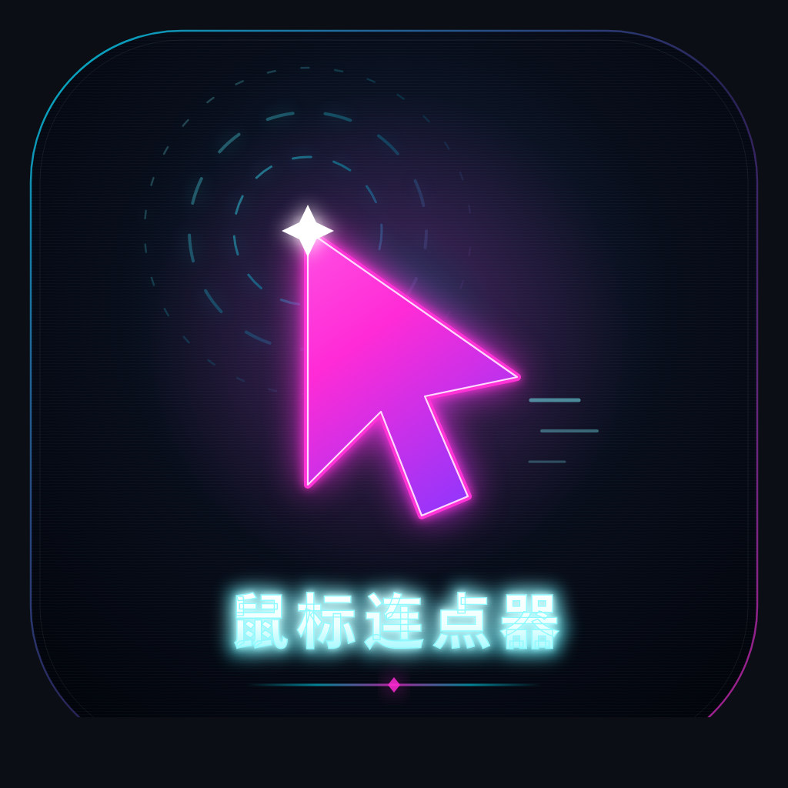
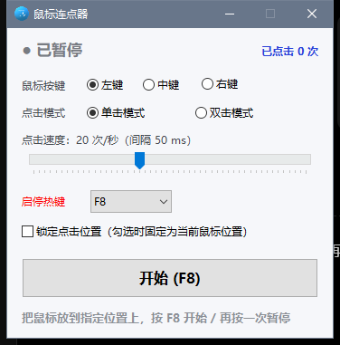
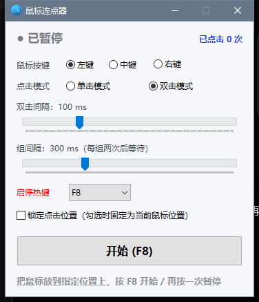

<p align="center">
  <a href="resources/logo/mouseclick-neon.svg">
    
  </a>
</p>

# 鼠标连点器（mouseclick）

一个运行在 Windows 桌面的鼠标连点工具：支持左键 / 中键 / 右键，支持单击与双击两种节奏，支持全局热键启停、锁定点击位置和配置记忆。界面由 **ENERGY GUI Designer + LCL** 构建，业务逻辑使用 Go。

> 适合重复点击、批量确认、界面测试等需要固定节奏点击的场景。请只在你有权操作的窗口和程序中使用。

## 界面预览

| 单击模式（默认 20 次/秒） | 双击模式（双击间隔 100 ms / 组间隔 300 ms） |
|:---:|:---:|
|  |  |

截图使用全新配置，未锁定点击位置。开始后会有 0.8 秒预热，状态从「即将开始」变为「运行中」，右上角显示累计点击次数。

## 功能

- **鼠标按键**：左键、中键、右键三选一。
- **单击模式**：按固定间隔连续点击，速度范围 1–50 次/秒，默认 20 次/秒（间隔 50 ms）。
- **双击模式**：每组连续点击两次后等待，再进入下一组。
  - 双击间隔：两次点击之间，范围 30–300 ms，默认 100 ms。
  - 组间隔：每组两次点击后等待，范围 20–1000 ms，默认 300 ms。
- **模式独立参数**：单击速度与双击间隔 / 组间隔分别保存，切换模式不会覆盖另一组参数。
- **全局热键启停**：默认 `F8`，可在下拉框选择 `Ctrl+F8`、`Ctrl+F9`、`Ctrl+F10`、`Alt+F8`、`Alt+F9`、`F8`–`F12`。
- **锁定点击位置**：勾选时把当前鼠标位置固定为点击点；运行中光标会被固定在该位置，适合点固定按钮。
- **配置记忆**：按键、模式、速度、双击参数、热键、锁定状态和坐标都会写入本地 JSON，下次启动自动恢复。
- **状态反馈**：显示「已暂停 / 即将开始 / 运行中」、累计点击次数和热键注册失败提示。
- **安全退出**：暂停或关闭窗口时先释放鼠标按键，再退出点击循环，避免鼠标键卡住。

## 快速开始

### 直接运行（推荐）

1. 进入项目的 `build` 目录。
2. 双击 `mouseclick.exe`。
3. 把鼠标移到要点击的位置。
4. 选择鼠标按键和点击模式，按需要调整速度或双击参数。
5. 按 `F8`（或你选择的热键）开始；再按一次暂停。

不需要打开控制台，程序是 Windows GUI 应用。当前仓库中的预构建程序为 x64 版本，适用于 Windows 10/11。

### 使用「锁定点击位置」

1. 先把鼠标移到目标位置。
2. 勾选「锁定点击位置」，程序会记录当前坐标。
3. 按热键开始后，光标会被固定在目标点。
4. 此时「开始 / 暂停」按钮可能被连点光标抢占，建议始终用全局热键暂停。

### 热键被占用

全局热键是系统独占的。若 `F8` 已被其他程序占用，窗口底部会显示红色提示；换一个热键即可。同时启动多个实例时，后启动的实例也会出现这个提示，这是正常现象。

## 依赖关系

程序入口和运行链路如下：

```text
main.go
  └─ lcl.Init() / lcl.Run(app.Forms...)
       └─ app.Form1（LCL 窗口和控件）
            ├─ app/form1.go       业务逻辑、事件、样式
            ├─ app/engine.go      连点引擎和状态机
            ├─ app/config.go      本地 JSON 配置
            └─ app/input_windows.go / hotkey_windows.go
                 └─ SendInput / RegisterHotKey（Windows 原生 API）
```

主要依赖：

| 依赖 | 版本 | 作用 |
|---|---|---|
| Go | 1.20+ | 编译和运行 |
| `github.com/energye/lcl` | `v1.0.9` | LCL 界面框架、窗口和原生控件 |
| `github.com/energye/energy/v3` | `v3.0.16` | `application/pack` 应用元信息、运行时集成 |
| `github.com/ebitengine/purego` | `v0.10.0`（间接） | LCL 依赖的动态库调用 |
| `libenergy-amd64.dll` | 由 ENERGY Designer 维护 | LCL 的 Windows 原生运行时 |

说明：

- 本机开发和运行由 ENERGY GUI Designer 维护 `%USERPROFILE%\.energy\runtime` 下的 `libenergy-amd64.dll`；本地 `build` 目录不需要手动复制 DLL。
- 如果要把程序分发到其他机器，请使用 Designer 的发布方式，或按 Designer 的运行时要求一起携带对应库，不要只拷贝单个 exe。
- macOS / Linux 目前只保留界面和配置逻辑的编译入口；鼠标注入和全局热键只在 Windows 下实现，不能实际点击。

## 从源码构建

### 命令行构建（Windows PowerShell / CMD）

```bat
git clone https://github.com/sxmxta/mouseclick.git
cd mouseclick
go mod download
```

如果 `build` 目录不存在，先创建：

```bat
mkdir build
```

然后构建：

```bat
go build -o build\mouseclick.exe .
```

构建完成后运行：

```bat
build\mouseclick.exe
```

### 用 ENERGY GUI Designer 构建

1. 用 ENERGY GUI Designer 打开 `mouseclick.egp`。
2. 在 Designer 里点击「构建」。
3. 输出目录为 `build/`，文件名由 `.egp` 的 `build_option` 配置为 `mouseclick`。
4. Designer 会处理本机 `libenergy` 运行时，不需要手动往 `build` 放 DLL。

### 开发检查

```bat
go vet ./...
go build -o build\mouseclick.exe .
```

项目同时通过了 Windows 386 的编译检查；当前预构建的 `build/mouseclick.exe` 是 amd64 版本。

## 配置记忆

配置文件路径：

```text
%LOCALAPPDATA%\mouseclick\config.json
```

目录名优先取 `app.Info.Name`；手动 `go build` 且 `Info.Name` 为空时回退为 exe 文件名。macOS / Linux 使用 `os.UserConfigDir()` 的系统配置目录。

默认配置：

```json
{
  "rate": 20,
  "button": "left",
  "hotkey": "F8",
  "mode": "single",
  "doubleGap": 100,
  "doubleInterval": 300,
  "lock": false,
  "lockX": 0,
  "lockY": 0
}
```

| 字段 | 说明 |
|---|---|
| `rate` | 单击模式速度，1–50 次/秒 |
| `button` | `left` / `middle` / `right` |
| `hotkey` | 热键名称，如 `F8`、`Ctrl+F8` |
| `mode` | `single`（单击）/ `double`（双击） |
| `doubleGap` | 双击两次点击之间的间隔，30–300 ms |
| `doubleInterval` | 双击每组结束后的组间隔，20–1000 ms |
| `lock` / `lockX` / `lockY` | 是否锁定点击位置及锁定的屏幕坐标 |

速度滑块使用 300 ms 防抖写盘；按键、模式、热键、锁定项即时排队写入；关闭窗口时强制落盘。配置损坏或数值越界会回退到默认值，不影响启动。删除配置文件即可恢复全部默认值。

## 目录结构

```text
mouseclick/
├── app/
│   ├── app.go                 窗体注册（设计器生成）
│   ├── form1.ui.go            由 layouts/form1.ui 生成的 UI 代码（不要手改）
│   ├── form1.go               业务逻辑、事件、样式
│   ├── engine.go              连点引擎、双击节奏和状态机
│   ├── config.go              AppData 配置路径、校验、JSON 写入
│   ├── input_windows.go       SendInput / 光标 / 1 ms 定时器
│   ├── input_other.go         非 Windows 编译占位
│   ├── hotkey_windows.go      RegisterHotKey 封装
│   ├── hotkey_other.go        非 Windows 编译占位
│   └── hotkey.go              修饰键常量
├── layouts/
│   └── form1.ui               设计器布局 JSON
├── resources/
│   ├── embed/                 应用图标（ico / png / icns）
│   ├── metadata/              Windows 元数据和本地化
│   └── logo/                  霓虹 Logo（SVG + PNG 预览）
├── docs/images/                README 使用截图
├── build/mouseclick.exe       预构建 Windows 程序
├── mouseclick.egp             设计器项目配置
├── go.mod / go.sum            依赖锁定
├── main.go                    程序入口
└── README.md
```

### 设计器约定

- `layouts/form1.ui` 是界面布局的权威来源，Designer 打开项目时据此恢复画布。
- `app/form1.ui.go` 是 Designer 生成的 UI 代码，**不要手改**；改布局请用 Designer，或同步修改 `.ui` 后重新生成。
- `app/form1.go` 是业务代码，Designer 用 AST 保护，不覆盖用户逻辑。
- 鼠标键三个 Radio 放在无边框、同底色的 `PanelKey` 中，仅用于隔离互斥组；单击 / 双击两个模式 Radio 直接挂在 Form 上。

## 已知限制

- 鼠标注入和全局热键目前只在 Windows 下实现；macOS / Linux 仅保证界面与配置逻辑可编译。
- 目标程序若以管理员权限运行，本工具也需要以管理员身份运行，否则 UIPI 可能拦截 `SendInput`。
- 少数内核级反作弊程序会忽略模拟点击，这是目标程序侧的限制。
- 锁定位置运行时请用热键暂停；暂停按钮可能被固定在目标点的光标影响。
- 全局热键被占用时换一个热键；程序不会强行抢占其他程序的注册。

## Logo

霓虹 Logo 源文件和预览：

- `resources/logo/mouseclick-neon.svg`
- `resources/logo/mouseclick-neon-preview.png`

SVG 字标已转曲，不依赖系统字体，可无损放大或用于 README / 应用展示。
